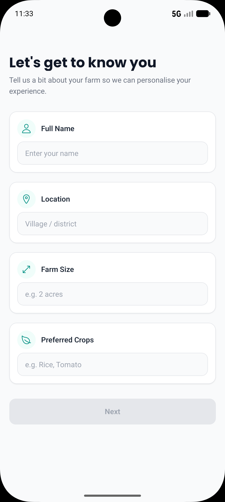
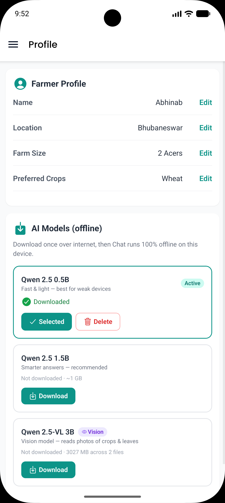
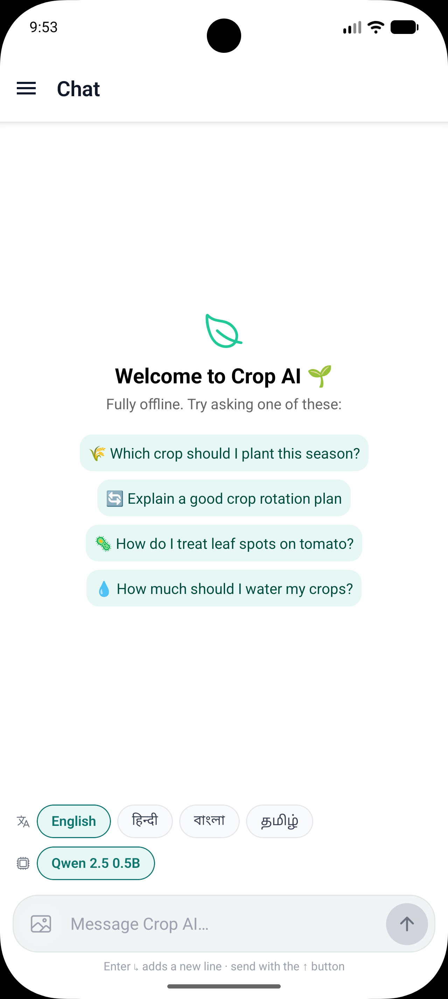
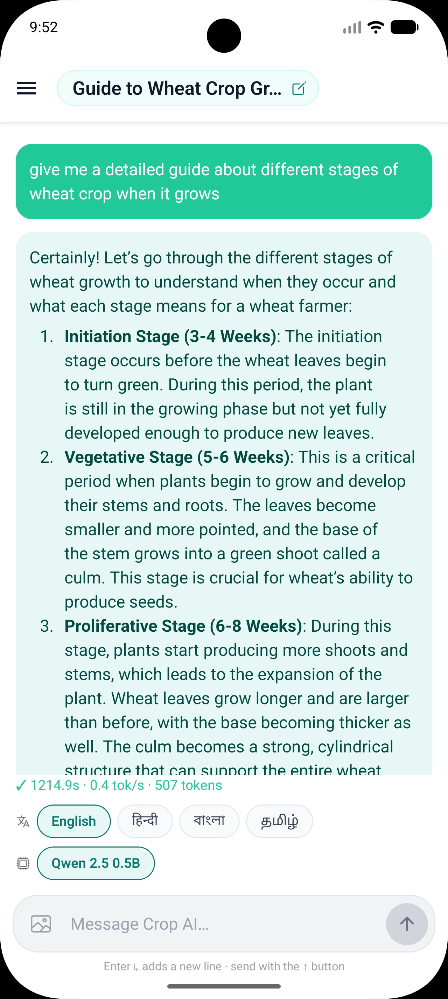
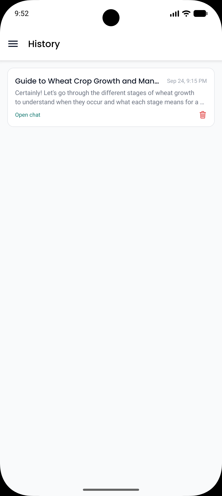
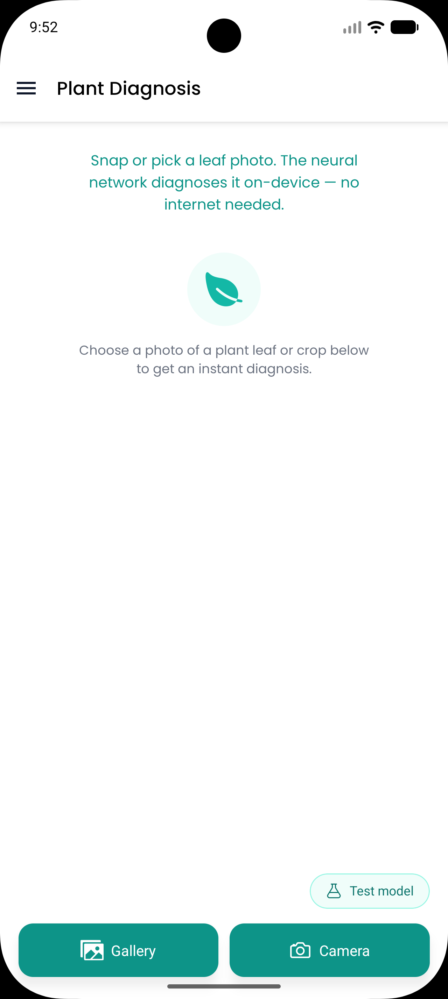

<div align="center">
  
  <h1>Crop AI</h1>
  <p><strong>AI-Powered Crop Diagnosis, Advisory & Multilingual Assistance</strong></p>
  <p>An end-to-end, mobile-first platform that helps farmers diagnose crop diseases,<br/>get intelligent recommendations — fully on-device.</p>
</div>

<p align="center">
  <a href="https://deepwiki.com/abhinab-choudhury/Crop-AI"></a>
  <a href="https://github.com/abhinab-choudhury/Crop-AI/releases"></a>
  
  
</p>

---

## Download the Android App

**[Download the latest Android APK](https://github.com/abhinab-choudhury/Crop-AI/releases)** — install on your Android device. First run downloads the on-device LLM + ONNX disease model (resumable, cancellable).

---

## Overview

Crop AI is a full-stack, AI-driven agriculture platform that helps farmers with:

- 🌱 **Plant disease detection** — from a photo of a leaf (ResNet9, 38 classes, on-device)
- 💬 **Conversational AI chat** — fully **offline / on-device** after a one-time download
- 🌾 **Crop recommendation & yield prediction**
- 🌍 **Region-aware agricultural guidance**
- 🗣 **Multilingual assistant** — English (default), हिन्दी, বাংলা, தமிழ்

Built as a **TurboRepo monorepo** (pnpm workspaces): Expo/React Native mobile app, React + Vite web landing page, FastAPI ML server. The mobile app runs its AI **fully on-device** — no inference API at runtime.

---

## System Architecture

```
        ┌────────────────────────────────────────────────────┐
        │                📱 Mobile App                       │
        │         React Native + Expo (NativeWind)           │
        │                                                    │
        │   ┌──────────────┐      ┌──────────────────────┐   │
        │   │  llama.rn    │      │ ONNX Runtime (RN)    │   │
        │   │  Qwen LLM +  │      │ ResNet9 disease      │   │
        │   │  vision (VL) │      │ classifier (38 cls)  │   │
        │   └──────┬───────┘      └──────────┬───────────┘   │
        │        all inference on-device,offline             │
        │          └──────────────┬──────────┘               │
        │                         ▼                          │
        │            SQLite (threads / messages / settings)  │
        └────────────────────────────────────────────────────┘
                       │  one-time download only
                       ▼
            Hugging Face (GGUF) • GitHub Releases (ONNX)
```

> **Fully on-device.** After a one-time model download, chat, vision, and disease diagnosis make **zero network requests**. Models live in the app's private document directory and are mmap'd into memory. See [docs/ON-DEVICE-MODELS.md](docs/ON-DEVICE-MODELS.md).

---

## Features

| Area | Capability | Status |
|---|---|---|
| 🤖 AI Chat | Conversational assistant (offline LLM) | ✅ |
| 🤖 AI Chat | Multilingual replies (EN / HI / BN / TA) | ✅ |
| 🤖 AI Chat | Vision model (Qwen 2.5-VL 3B, on-device) | ✅ |
| 🤖 AI Chat | Streaming replies + typing indicator | ✅ |
| 🤖 AI Chat | Markdown-formatted replies | ✅ |
| 🤖 AI Chat | Attach plant photos in chat | ✅ |
| 🤖 AI Chat | On-device chat title suggestions | ✅ |
| 🤖 AI Chat | Custom tool calling system | 🚧 |
| 🌿 Disease | On-device detection (ONNX ResNet9, 38 classes) | ✅ |
| 🌿 Disease | Resumable, cancellable download (progress/speed/ETA) | ✅ |
| 🌿 Disease | Works offline after download | ✅ |
| 🌿 Disease | Cloud fallback via FastAPI ML server | ✅ |
| 🌾 ML | Crop recommendation & yield prediction (XGBoost) | ✅ |
| 📱 Mobile | Chat history + AI-suggested thread rename | ✅ |
| 📱 Mobile | Email OTP login (JWT) | ✅ |
| 📱 Mobile | Android APK builds via GitHub Actions | ✅ |

---

## Tech Stack

| Layer | Tech |
|---|---|
| Mobile | React Native + Expo, NativeWind |
| On-device AI | `llama.rn` (Qwen GGUF), ONNX Runtime (ResNet9) |
| Web | React + Vite |
| ML / Backend | FastAPI, PyTorch, Scikit-learn, XGBoost |
| Monorepo | TurboRepo, pnpm, Docker |

---

## Project Structure

```
Crop-AI/
├── apps/
│   ├── native/       # Mobile app (chat, vision, disease detection)
│   ├── ml-model/     # ML training scripts + model artifacts
│   ├── ml-server/    # FastAPI ML server
│   ├── server/       # Express backend + MongoDB + Ollama
│   └── web/          # Web landing page (Vite)
├── docs/             # Architecture + on-device model guides
├── .github/workflows # Android APK build
└── package.json      # TurboRepo root
```

---

## Screenshots

<p align="center">
  <a href="docs/media/screenshots/on-boarding-1.png"></a>
  <a href="docs/media/screenshots/profile-screen.png"></a>
  <a href="docs/media/screenshots/chat-screen-2.png"></a>
</p>
<p align="center">
  <a href="docs/media/screenshots/chat-screen-1.png"></a>
  <a href="docs/media/screenshots/history-screen.png"></a>
  <a href="docs/media/screenshots/plant-disease-detection.png"></a>
</p>

---

## Build Your Own Binary

The native app uses custom native modules (`llama.rn`, ONNX Runtime), so it **cannot run in Expo Go**. The easiest way to get a working APK is via the provided **GitHub Actions** workflow — no local Android toolchain needed.

1. Fork the repo and push to `main` (or run the workflow manually).
2. Go to **GitHub → Actions → Build Android APK → Run workflow**.
3. Download the `crop-ai-apk` artifact from the completed run and install it.

For a local build (JDK 17 + Android SDK/NDK), see [apps/native/README.md](apps/native/README.md#building-the-android-apk).

> **Expo Go** can't run native AI modules — always use a dev build or the CI APK.

---

## Build Android APK

Native app builds into an installable `.apk` via GitHub Actions — no local toolchain needed:

```bash
git push origin main
```

Then GitHub → **Actions → Build Android APK → Run workflow**, download `crop-ai-apk` artifact.

For local builds (JDK 17 + Android SDK/NDK), see [apps/native/README.md](apps/native/README.md#building-the-android-apk).


